# Comparaison Landsat / Sentinel-2 / Kanopus-V et suivi de l'occupation du sol (Klaipėda, Lituanie)

> Quel capteur pour quel objet urbain ? Comparaison de trois satellites, puis analyse des changements 2013-2025 et carte web interactive.
> *Comparative performance of Landsat 8 OLI/TIRS, Sentinel-2 MSI and Kanopus-V for urban mapping, LULC change 2013-2025.*

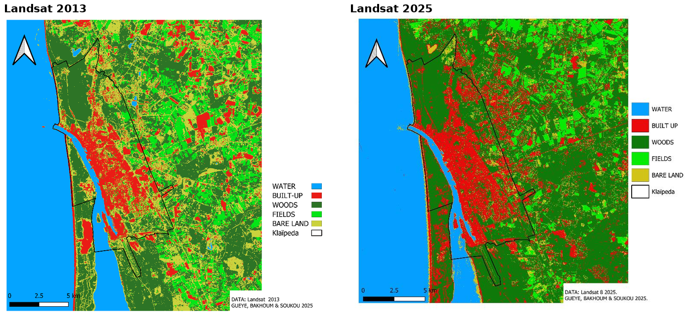

**Master 1 Géomatique et modélisation spatiale (GMS)**, Aix-Marseille Université | 2025-2026
**Travail de groupe** : M. Gueye, A. Bakhoum, A. E. Soukou | Rapport en anglais
Exercice individuel complémentaire sous TerrSet (LCM, HBM, ETM)

---

## Question

*Comment les différences spectrales, spatiales et temporelles entre Sentinel-2, Landsat OLI/TIRS et Kanopus-V influencent-elles la détection, la reconnaissance et la classification des objets urbains de Klaipėda ?*

## Données

| Capteur | Résolution | Usage |
|---|---|---|
| **Kanopus-V** (Roscosmos, nov. 2021) | Très haute résolution | Référence pour les objets urbains |
| **Sentinel-2 MSI** (ESA) | 10 m | Occupation du sol 2019-2025 |
| **Landsat 8/9 OLI-TIRS** (NASA/USGS) | 30 m (15 m pansharpené) | Occupation du sol 2013-2025 |
| **Urban Atlas 2018, Corine Land Cover 2018, OSM** | vecteur | Validation croisée |

## Méthode

**Partie 1, détection et reconnaissance des objets urbains**
- Typologie des objets (eau, champs, bois, sols nus, bâti) et **matrice de détectabilité** capteur × domaine spectral × objet
- Prétraitements : rééchantillonnage, pansharpening, ACP, MNF et compositions colorées
- Classifications : ISOCLUST, Random Forest, SVM et approche orientée objet (GEOBIA)
- Validation avec Urban Atlas, Corine Land Cover et OSM

**Partie 2, dynamique temporelle 2013-2025**
- Séries harmonisées Landsat et Sentinel-2 aux mêmes saisons
- **Land Change Modeler** : gains, pertes, contributions et tendance spatiale (polynôme d'ordre 3)
- **Habitat and Biodiversity Modeler** : attrition, agrégation et création de taches, surface et compacité des taches
- **Earth Trends Modeler** : projection 2025-2035 par chaînes de Markov

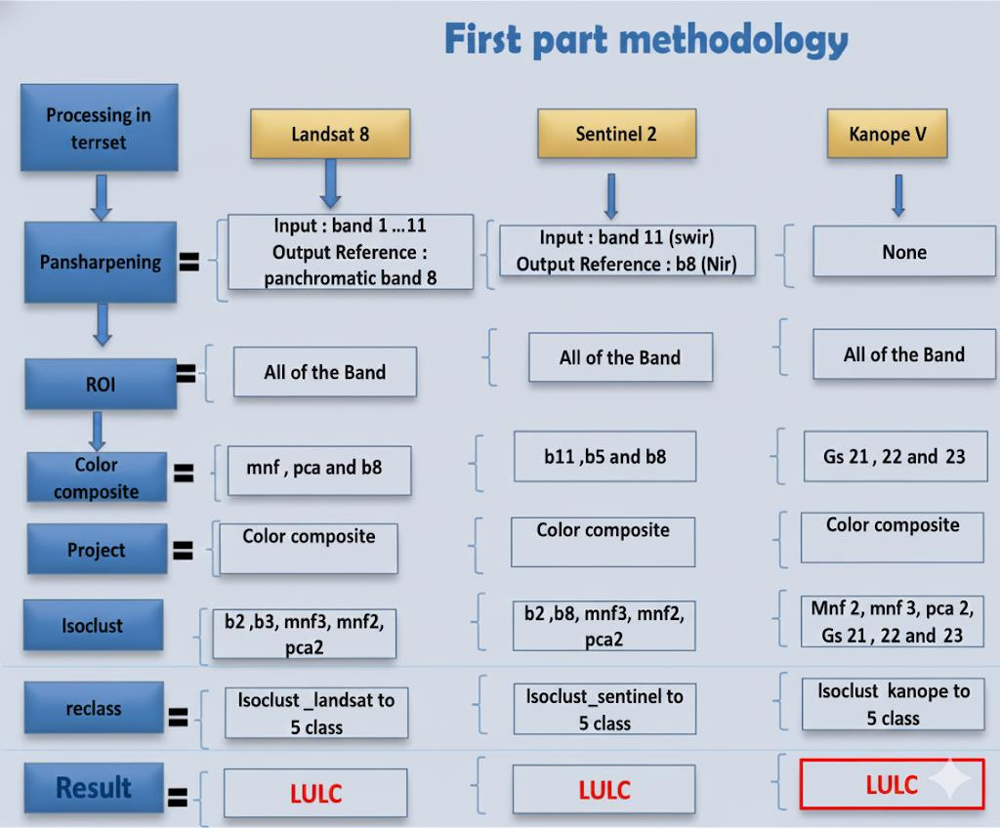

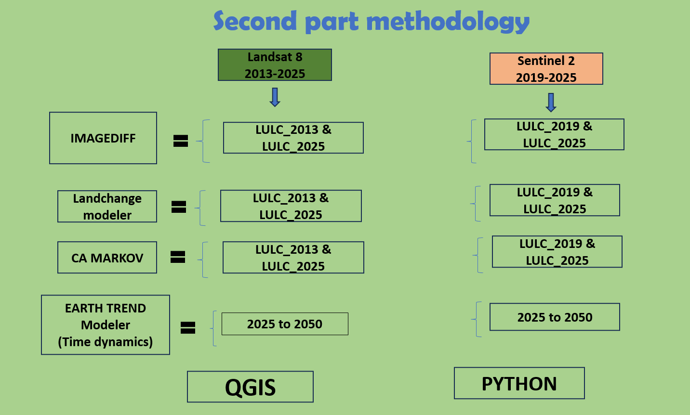

## Résultats clés

**Matrice de détectabilité**

| Objet | Landsat 8 | Sentinel-2 | Kanopus-V |
|---|---|---|---|
| Bâti | Élevée | Élevée | Élevée |
| Champs | Plutôt faible | Moyenne | Élevée |
| Bois | Faible | Moyenne | Élevée |
| Eau | Trop faible | Faible | Élevée |
| Sol nu | Très faible | Faible | Moyenne |

- **Le choix du capteur dépend de l'objet visé.** Kanopus-V isole bâtiments et rues, Sentinel-2 offre le meilleur compromis pour un suivi à échelle moyenne, et Landsat assure la continuité temporelle longue.

**Changements 2021-2025** (exercice TerrSet sur l'occupation du sol issue de Sentinel-2) :

- **Le bâti progresse de +1 211 ha net** (2 814 ha gagnés contre 1 600 ha perdus), **la végétation de +3 617 ha** et **l'eau de +420 ha**.
- **Les terres agricoles reculent de -3 299 ha et les sols nus de -1 949 ha**, au profit du bâti et de la végétation.
- **Le bâti gagne surtout sur la végétation** (549 ha), puis sur les sols nus (426 ha).

| Kanopus-V | Urban Atlas (référence) | Landsat 8 et Corine |
|---|---|---|
| 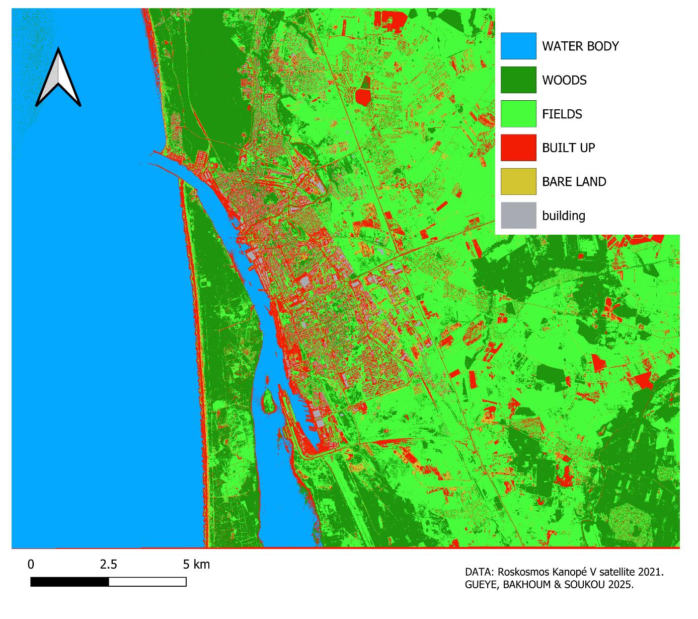 | 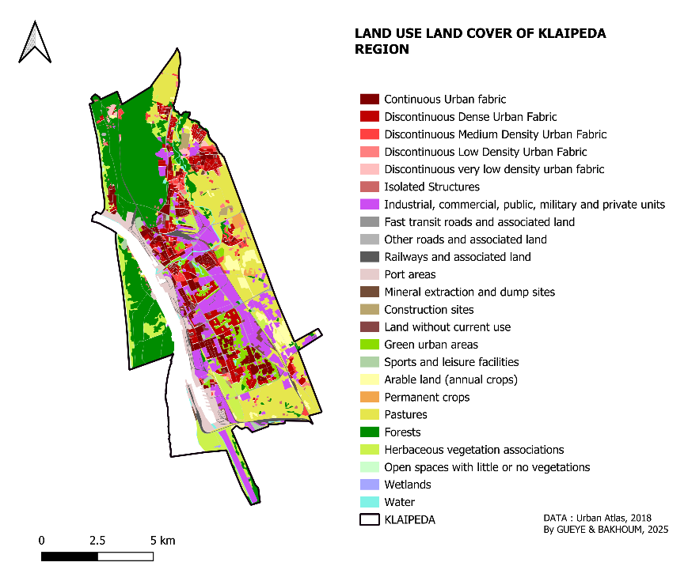 | 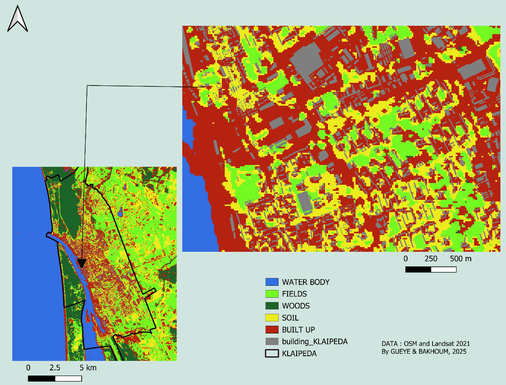 |

| Gains et pertes du bâti (LCM) | Tendance végétation vers bâti | Dynamique paysagère (HBM) |
|---|---|---|
| 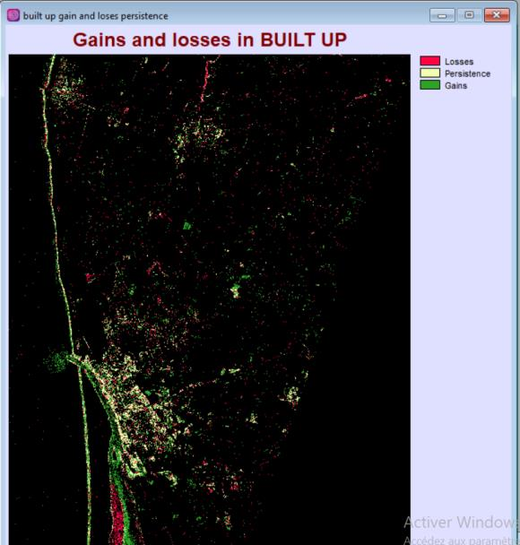 | 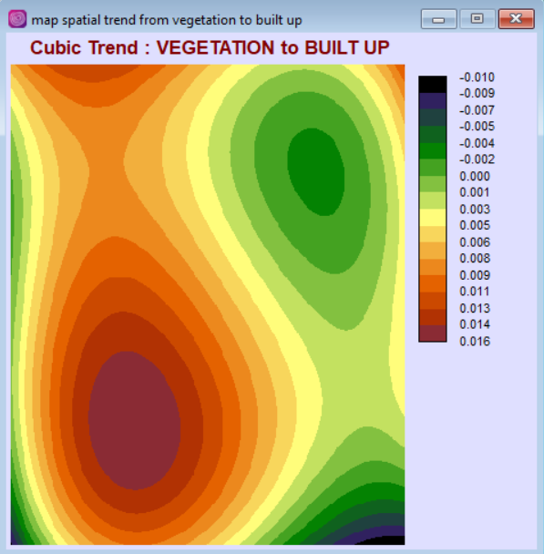 | 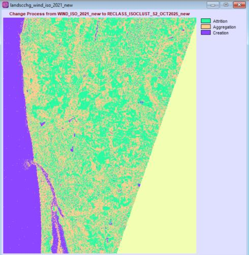 |

| Surfaces par classe, 2013 vs 2025 | Gains et pertes par classe (LCM) |
|---|---|
| 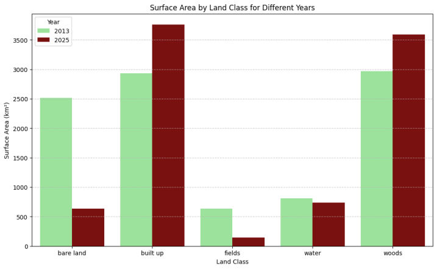 | 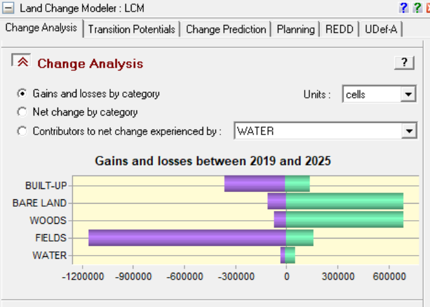 |

## Carte web

Une carte interactive (Leaflet, export qgis2web) superpose les occupations du sol 2013, 2019, 2021 et 2025, Urban Atlas, Corine Land Cover et le bâti. Elle est disponible sur demande.

## Outils

`TerrSet` (LCM, HBM, ETM) | `ENVI` | `QGIS` | `qgis2web` (Leaflet) | Random Forest | SVM | GEOBIA

## Contenu du dépôt

- `figures/` : méthodologie, cartes par capteur, changements, TerrSet
- `rapport/` : rapport de groupe (PDF, 40 p.) et exercice TerrSet individuel (PDF)

---

**Auteur :** Ezechiel Agbewanou SOUKOU, géomaticien-urbaniste | [LinkedIn](https://www.linkedin.com/in/ezechiel-soukou) | [Autres projets](https://github.com/ezekielofficiel7-spec)
